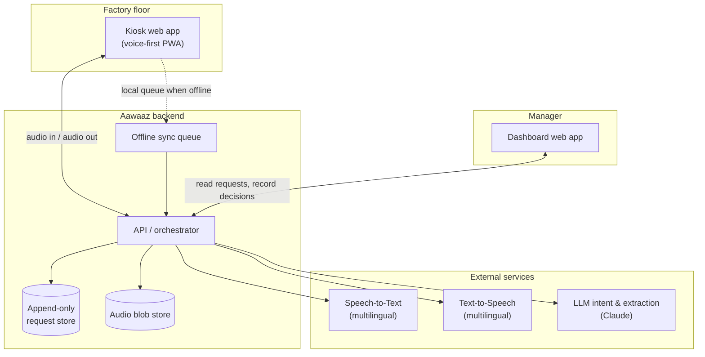
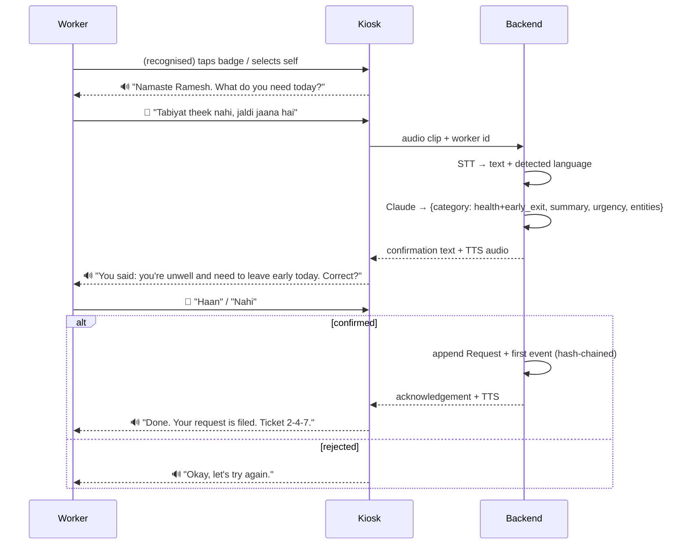

# Aawaaz — Architecture & Technical Plan

*Every worker's voice, on record.*

A voice-first web application: a **kiosk** on the factory floor where workers speak
requests in their own language, and a **dashboard** where managers see every request
in one prioritized, tamper-evident place.

---

## 1. Design principles

These drive every decision below.

1. **Voice is the primary interface, not a feature.** The worker should be able to
   complete a request with eyes closed and hands busy. Screen text is a fallback for
   the sighted/literate, never a requirement. Every prompt is spoken; every choice is
   offered aloud.
2. **The worker's language is the system's language.** No "please select English."
   Detect the language, respond in it, store the original audio *and* a translated text.
3. **Nothing is silently changed.** Requests are append-only and hash-chained. A status
   only ever moves forward through recorded events. Workers and managers see the same history.
4. **Degrade, don't fail.** Factory-floor networks blink. The kiosk must queue a request
   locally and still give the worker a spoken acknowledgement, then sync when it can.
5. **Consent and dignity.** The worker is told they're being recorded and why, in their
   language, the first time and on request. Voice data is sensitive personal data — treat it so.

---

## 2. System overview



The kiosk never holds any API keys or talks to speech/LLM vendors directly — the backend
orchestrates the whole pipeline so secrets stay server-side and vendors can be swapped.

---

## 3. The worker journey (kiosk)

### 3.1 Recognition — "who is this?"

Speaker-ID from voice alone is fragile in a loud factory and easy to spoof — **do not**
rely on it. Recommended, in order of robustness vs. cost:

| Method | How | Tradeoff |
|---|---|---|
| **RFID / NFC badge tap** *(recommended default)* | Worker taps existing ID badge on a reader wired to the kiosk | Reliable, instant, cheap, familiar. Needs a reader. |
| **Face recognition** | Kiosk webcam + on-device face match against enrolled photos | No extra hardware beyond camera; privacy-sensitive, lighting-dependent. |
| **Spoken worker ID + PIN** | "Say your worker number" | Pure web, no hardware; slower, error-prone in noise. |

Design the recognition step as a **pluggable identity provider** so the prototype can
start with "tap a photo on screen" / spoken ID and swap in RFID later without touching
the rest of the flow.

### 3.2 The request loop



Key points:
- **Confirm-back is mandatory.** The LLM's plain-language summary is read back before
  anything is filed. This is both an accuracy check and the worker's proof of being heard.
- **Short, numeric ticket IDs** spoken as digits ("two-four-seven") so a worker can
  remember it and later ask "what happened to two-four-seven?"
- **Barge-in**: the worker can speak over a prompt; don't force them to wait out the TTS.

### 3.3 Status check

A returning worker is recognised, says "status of my requests" (or taps a "my requests"
area), and hears each open request and its current state read aloud, newest first.

### 3.4 Kiosk UI constraints

- Giant tap targets, high contrast, icon-first (a cross for health, a clock for early
  exit, a rupee for advance), minimal words.
- A persistent, obvious **🎤 "Speak"** control and a **🔊 "Repeat that"** control.
- Auto-reset to the welcome screen after inactivity so the next worker starts clean —
  and so one worker never sees another's requests.
- Built as an installable **PWA** (fullscreen kiosk mode, service worker for offline).

---

## 4. The speech + understanding pipeline

### 4.1 Speech-to-Text and Text-to-Speech

Browser `Web Speech API` is tempting but **not recommended as the backbone**: coverage
of Indian regional languages is inconsistent across browsers, quality in noise is poor,
and it can't be relied on offline or on locked-down kiosk hardware. Use a server-side
multilingual service, abstracted behind our own `SpeechProvider` interface:

- **Bhashini / AI4Bharat (IndicConformer, IndicTTS)** — built specifically for Indian
  languages; strong fit for the target users; can be self-hosted for data control.
- **Sarvam AI** — Indian-language STT/TTS with good quality and simple APIs.
- **Google Cloud Speech-to-Text / Text-to-Speech** — broad language coverage, robust,
  easy to start with.

Start the prototype with whichever is fastest to wire up; the abstraction lets you
switch to a self-hosted Indic model later for cost and data residency.

> **Noise matters.** Spec a directional/noise-cancelling mic for the kiosk and consider
> VAD (voice-activity detection) to trim silence before STT. This affects accuracy more
> than the model choice.

### 4.2 Intent, categorization, extraction — the LLM step

A single Claude call turns transcribed text into structured, actionable data. This is
where the system is robust to how differently people phrase the same need across languages.

**Input:** transcript + detected language + worker context (name, role).
**Output (structured, e.g. tool-use / JSON):**

```json
{
  "category": "health" | "early_exit" | "leave" | "salary_advance" | "safety" | "other",
  "secondary_categories": ["early_exit"],
  "summary_en": "Feeling unwell, wants to leave early today.",
  "summary_native": "तबियत ठीक नहीं, आज जल्दी जाना चाहते हैं।",
  "urgency": "high" | "normal" | "low",
  "entities": { "date": "2026-11-27", "amount": null, "duration": null },
  "confidence": 0.0-1.0,
  "needs_clarification": false,
  "clarifying_question_native": null
}
```

- When `confidence` is low or the request is ambiguous, the model returns a
  `clarifying_question` instead of a category, and the kiosk asks it aloud — a natural
  back-and-forth rather than a wrong filing.
- **Safety and health** categories are flagged for priority at the source.
- Keep the category taxonomy in config so a factory can extend it.

---

## 5. Data model & the tamper-evident record

The integrity promise — *"recorded permanently and can't be quietly changed"* — is the
heart of the product. Implement it as **append-only event sourcing with a hash chain**.

### 5.1 Tables (relational, e.g. Postgres)

```
workers        (id, name, native_language, role, identity_ref, enrolled_at)
requests       (id, ticket_no, worker_id, created_at, category, urgency,
                summary_en, summary_native, audio_blob_ref, transcript)
request_events (id, request_id, seq, type, payload, actor_id, actor_role,
                created_at, prev_hash, hash)         -- APPEND ONLY
categories     (key, label, default_priority, is_safety_critical)   -- config
priority_rules (factory_id, category_key, weight)    -- manager-adjustable
users          (id, role: worker|manager|admin, auth_ref)
```

### 5.2 Why events, not a mutable status column

A request's lifecycle (`filed → acknowledged → in_progress → resolved → rejected`) is a
stream of `request_events`. The request's *current* status is a projection (the latest
event). Nothing is ever updated in place, so there is no way to quietly rewrite history —
a correction is itself a new, visible event.

### 5.3 The hash chain

Each event stores `prev_hash` (the previous event's hash for that request, or the global
chain) and `hash = SHA256(prev_hash + canonical(payload) + created_at)`. Tampering with
any past event breaks every subsequent hash — making alteration detectable. Periodically
anchor the latest global hash somewhere external (a signed daily digest emailed to
management, or a public timestamp) for stronger, independently-verifiable assurance.

> This gives tamper-*evidence* (you can prove if something changed) without the weight of
> a blockchain. That's the right altitude for a factory tool.

---

## 6. The manager dashboard

- **One prioritized queue.** Requests sorted by a score combining category weight,
  urgency, and age. Safety/health float to the top by default.
- **Adjustable priorities.** The manager tunes category weights (`priority_rules`);
  changes are themselves recorded events, so "why did this jump the queue" is answerable.
- **Act on a request** → records an event (acknowledge, mark in-progress, resolve with a
  note, reject with a reason). The worker can then hear that outcome at the kiosk.
- **Full history per request**, including the original audio clip and transcript, so a
  disputed leave or advance has a single source of truth.
- **At-a-glance metrics** tied to the success criteria (§9): open vs. resolved, median
  time-to-first-response, requests by category.
- Auth: simple email/password or SSO; role-gated. Managers never edit worker-authored
  content, only append their own events.

---

## 7. Offline & resilience

- Kiosk is a **PWA with a service worker**. If the backend is unreachable, the recorded
  audio + worker id are stored in **IndexedDB** and the worker still hears *"Your request
  is saved and will be filed — ticket pending."*
- A background sync flushes the queue when connectivity returns; STT/NLU then run and the
  ticket number is assigned. (Trade-off: no instant confirm-back of the parsed summary
  while offline — acceptable degradation; flag these for a quick manager glance.)
- Idempotency keys on queued requests so a retry never double-files.

---

## 8. Proposed stack (web app)

| Layer | Choice | Why |
|---|---|---|
| Kiosk + dashboard | **Next.js (React) PWA**, TypeScript | One codebase, SSR + API routes, easy PWA, strong ecosystem |
| Styling/UI | Tailwind + a component kit | Fast, accessible, large tap targets |
| Backend | Next.js API routes or a small **Node/Express** service | Keeps secrets server-side; orchestrates the pipeline |
| Database | **Postgres** (SQLite for the earliest prototype) | Relational integrity, easy hash-chain + event tables |
| Audio storage | Object store (S3-compatible) or local disk in prototype | Keep original clips for the record |
| Speech | `SpeechProvider` abstraction → Bhashini/Sarvam/Google | Swap vendors without touching flow |
| Understanding | **Claude** (latest Sonnet) via tool-use for structured output | Robust multilingual intent + extraction |

---

## 9. How we'll know it works (instrument from day one)

Wire these metrics into the event stream so they're free to measure:

- **Missed/forgotten requests → near zero.** Every spoken request produces a durable event.
- **Faster responses.** Median time from `filed` → first manager event, trended.
- **Sustained trust/usage.** Repeat workers per week; requests per active worker.
- **Accuracy.** Confirm-back rejection rate (how often the parsed summary was wrong) and
  clarification rate — both should fall as the pipeline improves.

---

## 10. Build roadmap

**Phase 0 — Walking skeleton (prove the loop).**
Next.js app; "select your photo" identity; record audio in browser → backend → one STT
call → one Claude classification → TTS confirm-back → file an append-only request →
show it on a bare dashboard. One language (e.g. Hindi) end to end.

**Phase 1 — The record & the dashboard.**
Hash-chained event store; status lifecycle; prioritized manager queue with safety/health
on top; act-on-request recording events; per-request history with audio playback.

**Phase 2 — Robust voice.**
Swap in the Indic speech provider; language auto-detect; barge-in; clarifying-question
loop; status-check-by-voice; noise handling.

**Phase 3 — Floor-ready.**
PWA kiosk mode + offline queue/sync; RFID identity; consent flow; inactivity reset;
adjustable priority rules; daily signed digest anchor; success metrics dashboard.

**Phase 4 — Scale & trust.**
Multi-factory config, roles/audit, data-retention policy for voice clips, independent
verification of the hash chain.

---

## 11. Open questions for the team

1. **Identity:** do target factories already issue RFID/NFC badges we can read?
2. **Languages at launch:** which specific regional languages must Phase 0/2 cover?
3. **Data residency / privacy:** does voice data have to stay in-country / self-hosted?
   (Pushes us toward self-hosted Bhashini/AI4Bharat over cloud vendors.)
4. **Who closes the loop?** Is the manager the only actor, or is there an HR/admin role
   and escalation for safety issues?
5. **Retention:** how long do we keep original audio clips vs. just transcripts?
