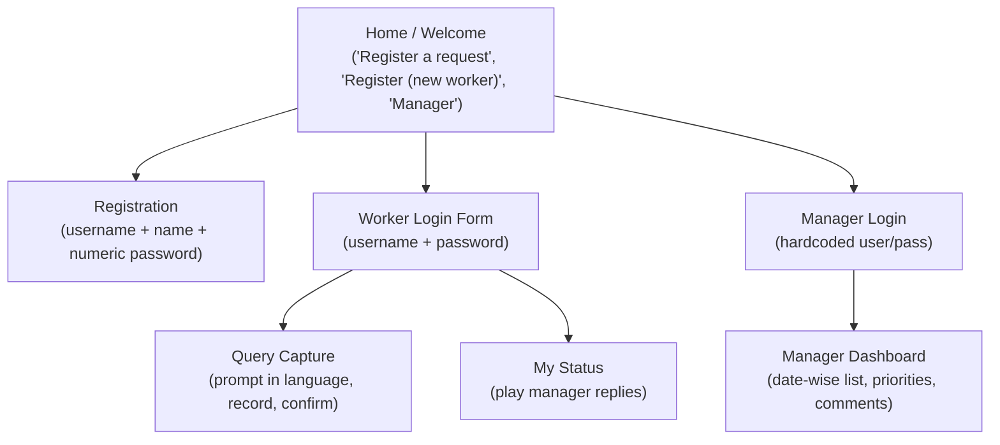

# Aawaaz — V1 Spec (Flutter / Android, hackathon build)

*Every worker's voice, on record.*

This is the **version-1 build target**: a single self-contained Flutter Android app.
No backend, no database, no cloud login. **All data lives in app memory** for this version.
(The longer-term web/backend vision lives in [DESIGN.md](DESIGN.md) — that is *not* what we build now.)

---

## 1. Scope of V1

**In scope**
- One Flutter app, runs as an Android application.
- **Registration**: enter username, actual name, and a simple numeric password (e.g. `1234`).
  That's it — no photo, no face.
- **Worker flow**: on the home screen tap **"Register a request"** → a form asks for
  username + password → on match, the voice flow opens → app asks (in the worker's language)
  for the query → worker speaks → query is categorized and stored.
- **Status check**: a returning worker (same username + password) can ask "what's the update
  on my query?" and the manager's reply is played back aloud.
- **Manager dashboard**: gated by a **hardcoded username + password**. Lists queries
  date-wise, lets the manager set category priorities and add a comment per query.

**Out of scope for V1** (explicitly deferred)
- **No face detection / face recognition.** Removed entirely from V1. (Comes back with the
  backend in a later version, likely done with Python ML server-side.)
- No backend, no network calls, no cloud database. Everything is in-memory.
- No Google / OTP / real authentication. Worker identity = username + numeric password;
  manager access = hardcoded credentials.
- **Pure in-memory: all data is lost when the app closes** (decided — see §9). Expect to
  re-register during the demo; seed demo data at startup to cover this.
- No LLM / cloud NLU. Categorization is **on-device, rule-based** for V1.

**Decided for V1**
- **Persistence:** pure in-memory (no local storage).
- **Languages:** Hindi (`hi-IN`), Bengali (`bn-IN`), English (`en-IN`).
- **Registration:** worker-only; managers reach the dashboard via the hardcoded login only.

---

## 2. User types & access model

| Who | How they get in | What they can do |
|---|---|---|
| **Worker** | Registers with username + name + numeric password. Later identified by entering username + password. | Speak a query, check the status of their queries. |
| **Manager** | Enters a **hardcoded username + password** on the manager login screen. | See all queries date-wise, set category priorities, add a comment/reply to a query. |

> **V1:** registration is **worker-only**. The manager is not a registered user at all; the
> manager **dashboard** is reached purely through the hardcoded login. Suggested default
> manager credentials: username `admin`, password `admin123` (one constant, easy to change).
> Worker passwords are simple numeric PINs (e.g. `1234`) — this is lightweight demo
> identity, not real security.

---

## 3. Screens & navigation



### 3.1 Home / Welcome
- Three large buttons: **"Register a request"** (the main worker action),
  **"Register"** (new worker sign-up), and a smaller **"Manager"** entry.
- Everything voice-assisted: on load, TTS speaks a short welcome.

### 3.2 Registration (new worker)
- Text fields: **Username**, **Name** (actual name), **Numeric password** (PIN, e.g. `1234`).
- Dropdown: **Language** (Hindi / Bengali / English — used for all future prompts to this
  worker).
- On save: store the `Worker` record in memory. Speak confirmation.
- Guard: reject a username that already exists; require a non-empty numeric PIN.

### 3.3 Worker Login (identity check)
- Reached by tapping **"Register a request"** (or a "My status" entry) on the home screen.
- A form/dialog asks for **Username** + **Password**.
- Match against the in-memory worker list. On match → greet by name and continue to Query
  Capture (or My Status). On mismatch → "Username or password incorrect. Try again."

### 3.4 Query Capture
1. TTS in the worker's regional language: "Tell me what you need." (prompt language =
   the worker's registered/selected language; see §6).
2. **STT** records the spoken query → transcript + locale.
3. **Categorize** the transcript on-device (§7) → category + urgency.
4. **Confirm-back**: TTS reads a plain summary ("You said: you want leave tomorrow.
   Correct?") → worker says yes/no.
5. On yes → store a `Query` record (worker id, timestamp, transcript, category, status =
   `open`). Speak acknowledgement with a short ticket number. On no → retry.

### 3.5 My Status
- After logging in, the worker can instead say / tap "status of my requests."
- App lists that worker's queries (newest first) and, for each, **plays the manager's
  comment aloud** via TTS (and shows it as text). If no comment yet: "Still pending."

### 3.6 Manager Login
- Username + password fields. Compare against hardcoded constants. On success → Dashboard.

### 3.7 Manager Dashboard
- **Date-wise grouped list** of all queries (today, yesterday, …), each showing worker
  name, category, urgency, transcript, status, and any existing comment.
- **Sort by priority**: queries ordered by their category's priority weight (safety/health
  high by default), then recency.
- **Set priorities**: a settings area to adjust each category's priority weight.
- **Add comment / reply**: manager types a comment and optionally sets status
  (`open → in_progress → resolved`). This is what the worker later hears in My Status.

---

## 4. In-memory data model

All held in a single in-memory store (e.g. a `ChangeNotifier` / Provider or Riverpod
repository). Shapes:

```dart
class Worker {
  String id;              // uuid
  String username;        // unique, used to log in
  String name;            // actual display name
  String password;        // simple numeric PIN, e.g. "1234"
  String languageCode;    // "hi-IN" | "bn-IN" | "en-IN", chosen at registration
  DateTime registeredAt;
}

class Query {
  String id;              // uuid
  int ticketNo;           // short, spoken back to worker
  String workerId;
  DateTime createdAt;
  String transcript;      // raw spoken text
  String languageCode;
  String category;        // key from Category list
  Urgency urgency;        // high | normal | low
  QueryStatus status;     // open | inProgress | resolved
  String? managerComment; // played back in My Status
  DateTime? commentedAt;
}

class Category {
  String key;             // "leave", "early_exit", "advance", "health", "safety", "other"
  String label;
  int priority;           // manager-adjustable weight; higher = sorts first
  bool isSafetyCritical;  // seeds a high default priority
}
```

Seed the category list at startup with sensible defaults (safety & health highest).

---

## 5. Identity — username + numeric password

No face, no camera in V1. Identity is deliberately trivial:

- **Register**: username + name + numeric PIN, stored in the in-memory worker list.
- **Log in**: enter username + PIN; look up the worker and compare. Match → proceed.
- This is demo-grade identity, not security. It keeps the whole app in-memory and the voice
  loop as the real focus.

Keep login behind a single `IdentityService.authenticate(username, pin)` method so a later
version can swap in real auth (or the face/Python-ML approach, done server-side) without
touching the UI.

---

## 6. Voice — speech in & out

- **Languages for V1**: Hindi (`hi-IN`), Bengali (`bn-IN`), English (`en-IN`).
- **STT**: `speech_to_text` package → uses Android's on-device recognizer. Set `localeId`
  to the worker's language. Note: available locales depend on the device's installed Google
  speech languages — **install/verify hi-IN, bn-IN, en-IN on the demo device beforehand**
  (Android Settings → Languages & input → voice). en-IN is the most reliable fallback.
- **TTS**: `flutter_tts` → set language to match; all three locales are widely supported.
  Use it for every prompt, the confirm-back, the acknowledgement, and manager comments.
- **Language**: pick the worker's language at registration and store it on the `Worker`;
  all prompts for that worker use it. (No auto-detect in V1 — keep it simple.)

---

## 7. Query categorization (on-device, no LLM in V1)

Without a backend or LLM, use **rule-based keyword matching** against the transcript:

- Each `Category` has a keyword set, per supported language
  (e.g. leave → {"leave","chhutti","ছুটি"}, advance → {"advance","paisa","salary"},
  health → {"tabiyat","bimar","not feeling well"}, safety → {"danger","accident","fire"}).
- Match transcript → first/best-matching category; default to `other` if nothing matches.
- `isSafetyCritical` categories seed `urgency = high`.

> This is deliberately crude and the obvious upgrade point for V2 (swap this one function
> for an LLM call). Keep categorization behind a single `Categorizer` function so the
> replacement is a one-file change.

---

## 8. Suggested package list

| Need | Package |
|---|---|
| Speech-to-text | `speech_to_text` |
| Text-to-speech | `flutter_tts` |
| State / in-memory store | `provider` or `riverpod` |
| IDs | `uuid` |

No camera, face, or ML packages in V1.

---

## 9. Persistence — decided: pure in-memory

All data lives in app memory and **is lost when the app closes**. No `hive` /
`shared_preferences`, no files, no server. Consequences to design around:

- Expect to **re-register workers** if the app is restarted during the demo.
- Provide a **"seed demo data" step at startup** (a few pre-registered workers with sample
  queries) so the manager dashboard isn't empty on a fresh launch, and so a restart mid-demo
  recovers quickly. Keep this seed toggleable/clearly marked.
- Keep the in-memory store behind a single repository class so V2 can add persistence
  without touching the UI.

---

## 10. Implementation tracker (incremental build)

Built step by step. Legend: `[ ]` not started · `[~]` in progress · `[x]` done.

### Step 0 — Project setup
- [x] Flutter project scaffolded at `aawaaz-mobile/` (Android, org `com.sympharix`).
- [x] Add dependencies to `pubspec.yaml` (`speech_to_text`, `flutter_tts`, `provider`, `uuid`).
- [x] Android permissions in `AndroidManifest.xml` (microphone / `RECORD_AUDIO`, STT/TTS queries).

### Step 1 — Shell + navigation + in-memory store
- [x] Data models: `Worker`, `Query`, `Category` (§4).
- [x] In-memory repository (`AppRepository`, `ChangeNotifier`) with seeded categories.
- [x] Home screen: "Register a request", "Register", "Manager" (§3.1).
- [x] Routing between screens (placeholder screens for Steps 2–4 wired up).

### Step 2 — Registration (new worker)
- [x] Form: username + name + numeric PIN + language (§3.2).
- [x] Save `Worker` to repository; reject duplicate username.
- [ ] (Optional dev aid) list of registered workers. *(skipped for now)*

### Step 3 — Worker login
- [x] Authenticate via `AppRepository.authenticateWorker(username, pin)` (§5).
- [x] Login form; greet on success (→ query flow), error on mismatch.

### Step 4 — Manager login + dashboard
- [x] Hardcoded manager login (`admin` / `admin123`, from `AppConstants`).
- [x] Dashboard: queries grouped date-wise, sorted by category priority (§3.7).
- [x] Add comment + change status per query (bottom sheet).
- [x] Set/adjust category priorities (sliders).
- [x] Demo seed data at startup so the dashboard is populated (also covers Step 7's seed).

### Step 5 — Worker query capture (core loop)
- [ ] TTS prompt in the worker's language (§6).
- [ ] STT capture of the spoken query.
- [ ] `Categorizer` rule-based keyword matching → category + urgency (§7).
- [ ] Confirm-back (TTS summary → yes/no).
- [ ] Store `Query`; speak acknowledgement with ticket number.

### Step 6 — My Status
- [ ] List the logged-in worker's queries (newest first).
- [ ] Play the manager's comment aloud via TTS; "still pending" if none.

### Step 7 — Polish
- [ ] Regional-language prompt strings (hi/bn/en).
- [ ] Bigger tap targets, high contrast, icon-first.
- [x] Startup demo seed data (workers + sample queries) — done in Step 4.

> The voice loop (Step 5) is the centerpiece; nothing depends on camera/ML. Steps 1–6 give a
> fully demoable app.

**Current status:** Steps 0–4 done. Manager can log in and see demo-seeded requests grouped
by date, sorted by priority, and add comments / tune priorities. The only missing core piece
is **Step 5 (voice query capture)** — the worker side currently ends on a placeholder.
Next up: Step 5, then Step 6 (My Status).

---

## 11. Resolved decisions

1. **Languages:** Hindi (`hi-IN`), Bengali (`bn-IN`), English (`en-IN`). ✅
2. **Persistence:** pure in-memory, no local storage. ✅
3. **Registration:** worker-only; manager uses hardcoded login only. ✅

Still to confirm when convenient:
- Default manager credentials — keep `admin` / `admin123` or set your own?
