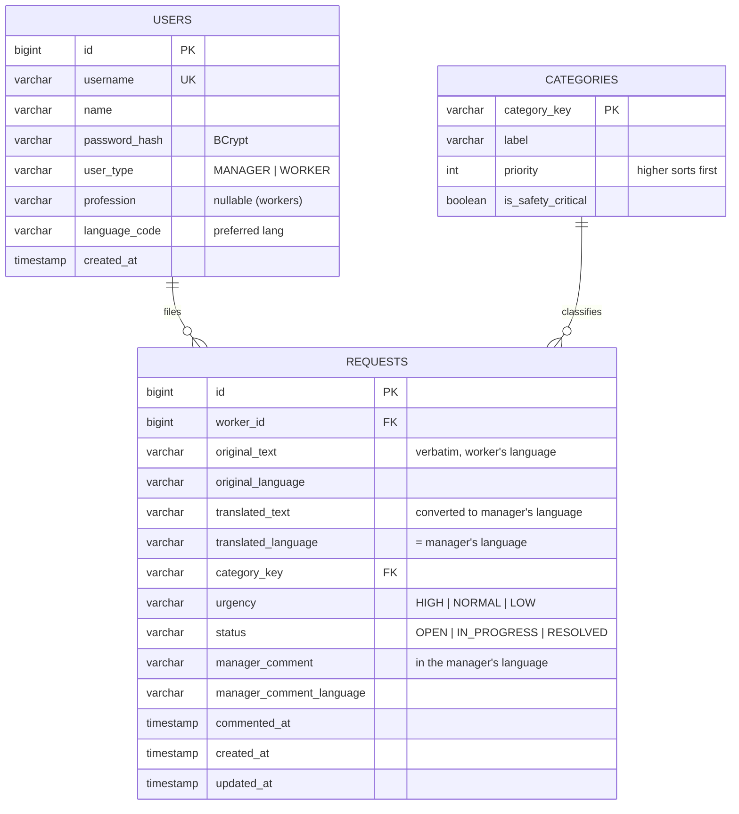

# Aawaaz — V2 Spec (Backend)

*Every worker's voice, on record.*

This is the **backend** specification. It is a living document: the data model is drafted
first (below), and the rest is filled in as decisions are made. The mobile app (V1) is
specified in [`SPEC_V1.md`](SPEC_V1.md); the long-term vision is in [`DESIGN.md`](DESIGN.md).

> **Status:** drafting. Data model defined. **No backend code is being written yet** — this
> doc is approved section by section before implementation.

---

## 1. Scope & decisions

- **Service:** Java / **Spring Boot 4** (Java 17), in `aawaaz-backend/` (scaffold already merged).
- **Database:** **in-memory H2** only (hackathon). Data resets on every restart; schema and
  seed data are recreated on each start. No Postgres/persistence in V2.
- **Schema & seed:** **Spring Boot SQL init** (`schema.sql` + `data.sql`) creates the tables
  and seeds default data (manager + categories) on every startup. Hibernate `ddl-auto=none`.
  *(Flyway was the original plan, but its H2 support module isn't published to Maven Central
  for Spring Boot 4's Flyway version — only in Redgate's auth-gated repo — and Flyway's
  versioning adds nothing to an in-memory DB that resets each run. Flyway can return for
  Postgres later, where its DB module is on Central.)*
- **Passwords:** stored as **BCrypt hashes**, never plaintext.
- **Out of scope for now:** the tamper-evident hash-chained record from `DESIGN.md`; real
  auth tokens/sessions; multi-factory support. (Can be revisited later.)

---

## 2. Data model

Three tables: **users** (managers + workers in one table), **categories**, **requests**.

### 2.1 `users` — managers and workers in one table
- `user_type`: `MANAGER` or `WORKER`.
- Registration from the app creates `WORKER` rows (with a `profession`); managers are seeded.
- `profession`: the worker's trade/role (e.g. operator, helper) — nullable; null for managers.
- `language_code`: the user's preferred language. A **worker** speaks in it; a **manager**
  reads translated requests in it.
- `password_hash`: BCrypt. The default manager is `admin` / `admin123`.

### 2.2 `categories` — mirrors the mobile app
Same set and defaults the app seeds, **seeded by Flyway and static** — the manager cannot add
or remove categories; only `priority` is mutable (higher sorts first):

| key | label | priority | safety-critical |
|---|---|---:|:---:|
| safety | Safety | 100 | ✓ |
| health | Health | 90 | ✓ |
| early_exit | Early exit | 60 | |
| leave | Leave | 50 | |
| advance | Salary advance | 40 | |
| other | Other | 10 | |

### 2.3 `requests` — what a worker says
- `original_text` + `original_language`: the worker's **exact** spoken phrase, stored
  verbatim and never altered (e.g. `मेरे को कल 2 दिन के लिए छुट्टी चाहिए`, `hi-IN`).
- `translated_text` + `translated_language`: the same request **converted to the manager's
  language** by the Java service and stored, so the manager reads it directly. See §3.
- `category_key` → `categories`; `urgency`, `status` as enumerated above.
- `manager_comment` (+ `manager_comment_language`, `commented_at`): the manager's reply,
  stored **in the manager's language**; the mobile app converts it to the worker's language
  on playback (see §3).

---

## 3. Multilingual handling (the key requirement)

A worker may speak in **any** language (Hindi, Bengali, English, …) and the manager may prefer
a **different** one. There are two translation directions, handled in two different places:

### 3.1 Worker → manager (translated and stored by the backend)
When a request is filed:
1. **Store verbatim.** The worker's exact phrase goes into `original_text` /
   `original_language`, never altered.
2. **Translate for the manager and store it too.** The Java service converts the phrase into
   the **manager's preferred language** (from the manager's `language_code`) and stores it in
   `translated_text` / `translated_language`.

So each request row holds **both** records: what the worker actually said, and what the
manager should see. The manager dashboard reads `translated_text` directly — no translation at
read time. (V2 assumes the single default manager; the translation targets that manager's
language. If English is unavailable as a target it can be used as a fallback.)

### 3.2 Manager → worker (translated on the frontend)
When the manager replies, the comment is stored **as typed, in the manager's language**
(`manager_comment` / `manager_comment_language`). The backend does **not** translate it. When
the worker opens "My requests," the **mobile app** converts the comment into the worker's
language for display/playback. The backend just serves the stored manager-language text.

> The translation engine itself (cloud API vs. library) is a later decision; the schema is
> independent of it. The backend owns worker→manager translation; the app owns manager→worker.

---

## 4. Default seed data (via `data.sql`)

- **Manager:** `admin` / `admin123` (BCrypt), `language_code = en-IN`.
- **Categories:** the six rows in §2.2.

Because the DB is in-memory, this seed is reapplied on every app start.

---

## 5. API design

All under base path `/api`, JSON in/out. **No auth at all in V2** (decided): no JWT, no
tokens, no session — the endpoints are open. `login` simply validates credentials and returns
the user record; the client passes the relevant `workerId` / `managerId` on later calls.

### 5.1 Auth

**`POST /api/auth/login`** — one login for both managers and workers.
- Request: `{ "username": "...", "password": "..." }`
- Response `200`: `{ id, name, userType, languageCode, profession? }` (never the hash)
- `401` if credentials don't match.
- Covers the manager-login requirement **and** worker login (see gap G1).

### 5.2 Registration

**`POST /api/workers`** — register a worker (creates a `WORKER` row).
- Request: `{ username, name, password, profession, languageCode }`
- Response `201`: the created user (no hash). `409` if the username already exists.
- Server BCrypt-hashes the password before storing.

### 5.3 Requests (queries)

**`POST /api/requests`** — a worker files a request.
- Request: `{ workerId, originalText, originalLanguage, categoryKey, urgency }`
- The mobile app already classifies on-device, so it **sends `categoryKey` and `urgency`**;
  the backend does not re-categorize in V2 (it validates `categoryKey` against the static
  category list). Server stores `originalText`/`originalLanguage` verbatim **and** fills
  `translated_text`/`translated_language` by converting into the manager's language (§3.1).
  Returns `201` with the created request.

**`GET /api/requests`** — listing, for the manager's daily view.
- Query params: `date=YYYY-MM-DD` (a single day; the "particular day" filter), optional
  `status`, optional `categoryKey`.
- Sorted by category priority (safety/health first), then newest first.
- Response: list of requests, each with `originalText` **and** the already-stored
  `translatedText` (no translation at read time — it was stored on create, §3.1).

**`GET /api/requests?workerId={id}`** — a worker's own requests (the app's "My status").
- Returns that worker's requests newest-first, with `managerComment` for playback. (Gap G2.)

**`PATCH /api/requests/{id}`** — manager updates a request.
- Request (any subset): `{ status, managerComment, managerCommentLanguage }`
- The comment is stored **as-is in the manager's language**; the backend does not translate it
  (the app converts it for the worker on playback, §3.2). Sets `commented_at`/`updated_at`.
  Returns the updated request. Covers "resolved or not + manager's input/approval."

### 5.4 Categories

**`GET /api/categories`** — list categories with current priorities. (Gap G3 — needed by the
dashboard and the priority screen.)

**`PUT /api/categories/{key}/priority`** — set a category's priority. (The **only** mutation
allowed on categories — they are otherwise static; no create/delete.)
- Request: `{ priority: <int> }` → returns the updated category.

### 5.5 Gaps I'm flagging (APIs you didn't list but we need)

- **G1 — Worker login / identity.** You named only manager login, but a worker must be
  identified to file a request and to view status. Folded into the unified `POST
  /api/auth/login` above; alternatively keep a separate worker login.
- **G2 — Worker's own request listing.** The app's "My requests" screen needs the worker to
  fetch their own requests and hear the manager's reply. Added as `GET
  /api/requests?workerId=`.
- **G3 — List categories.** You listed *setting* a priority but not *reading* categories; the
  dashboard and priority screen need `GET /api/categories`.
- **G4 — Manager language preference.** The request is translated into the manager's language
  **at create time** (§3.1), so the listing needs no `lang` param. The manager's
  `language_code` (returned by `login`) is the translation target. (Optional later: an endpoint
  to change a manager's preferred language — would only affect requests filed after the change.)

### 5.6 Nice-to-have (not required for V2)
- `GET /api/requests/{id}` (single request), `GET /api/workers` (list workers). Skip unless needed.

---

## 6. Implementation tracker

Legend: `[ ]` not started · `[~]` in progress · `[x]` done.

### Step B0 — Persistence setup ✅
- [x] Add dependencies: `spring-boot-starter-data-jpa`, `h2` (runtime).
- [x] Configure H2 in-memory datasource + `spring.jpa.hibernate.ddl-auto=none` +
  `spring.sql.init.mode=always` + H2 console.

### Step B1 — Schema & seed (§2 data model) ✅
- [x] `schema.sql`: `users`, `categories`, `requests` + indexes + constraints.
- [x] `data.sql`: seed default manager (`admin`/`admin123`, BCrypt) and the six categories.
- [x] Verify schema + seed on startup — `SchemaSeedTest` asserts the manager, 6 categories,
  safety's priority, and the empty `requests` table.

### Step B2 — Entities & repositories ✅
- [x] JPA entities (`User`, `Category`, `Request`) + enums (`UserType`, `Urgency`,
  `RequestStatus`) mapped to the schema.
- [x] Spring Data repositories (`UserRepository`, `CategoryRepository`, `RequestRepository`).
- [x] `RepositoryTest` verifies seed reads + a worker/request save round-trip.

### Step B3 — Auth & registration APIs ✅
- [x] `POST /api/auth/login` (§5.1) — validates credentials, returns the user; 401 on mismatch.
- [x] `POST /api/workers` registration (§5.2) — BCrypt hashing; 201 / 409 on duplicate / 400 on invalid.
- [x] `UserService` + `BCryptPasswordEncoder` (via `spring-security-crypto`, no security filter).
- [x] `AuthRegistrationTest` (MockMvc): seeded-manager login, wrong password, register→login, duplicate, invalid.

### Step B4 — Request APIs ✅
- [x] `POST /api/requests` (§5.3) — stores verbatim + manager-language translation (via
  `TranslationService`, currently a pass-through stub). 404 unknown worker / 400 unknown category.
- [x] `GET /api/requests` daily listing with `date`/`status`/`categoryKey` filters + priority sort.
- [x] `GET /api/requests?workerId=` worker's own list (§5.3 / G2).
- [x] `PATCH /api/requests/{id}` status + manager comment (sets `commentedAt`/`updatedAt`); 404 if missing.
- [x] `RequestApiTest` (MockMvc): create, 404/400 cases, priority sort, worker filter, update, 404.

### Step B5 — Category APIs
- [ ] `GET /api/categories` (§5.4 / G3).
- [ ] `PUT /api/categories/{key}/priority` (§5.4).

### Step B6 — Translation service
- [~] `TranslationService` interface in place; wired into request create. **Pass-through stub**
  for now (`PassThroughTranslationService`) — real engine still to come.
- [ ] Worker language → manager language on **create**, stored in `translated_text` (§3.1).
- [ ] Manager→worker translation is **not** backend work — handled by the mobile app (§3.2).
- [ ] Engine choice (cloud API / library) — TBD.

### Later
- [ ] Point the mobile app at the backend (incl. app-side manager→worker reply translation).

**Current status:** B0–B4 done — persistence, schema+seed, entities/repos, auth+registration,
and the request APIs are in place and tested (20 tests). Translation is a pass-through stub.
Next: B5 (category APIs), then B6 (real translation engine).

---

## 7. Decisions & open questions

**Resolved**
- **Auth:** none in V2 — no JWT/token/session; endpoints are open. ✅
- **Categories:** static, Flyway-seeded; no add/remove, only `priority` is mutable. ✅
- **Categorization:** the mobile app sends `categoryKey` + `urgency`; the backend does not
  re-categorize. ✅
- **Manager credentials:** keep default `admin` / `admin123`. ✅
- **Profession:** free text for V2 (no lookup table). ✅

- **Multilingual storage:** store **both** the verbatim phrase **and** a manager-language
  translation on each request (`original_text` + `translated_text`); manager reads the stored
  translation directly. Manager replies are stored in the manager's language and translated to
  the worker's language **by the mobile app** on playback. ✅ (§3)

**Still open**
- *(none — ready to implement from Step B0 on your go-ahead.)*
